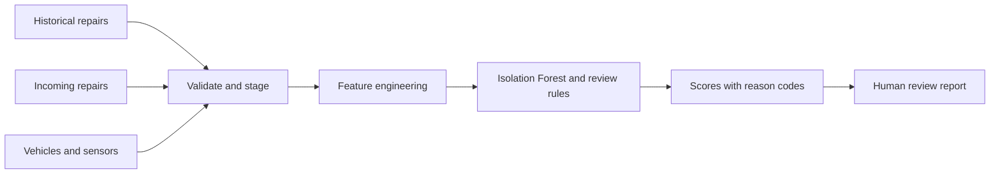

# Architecture and operational notes

## Scope

The workflow is an offline batch demo for claim triage. It intentionally uses synthetic CSV inputs and a local Postgres-backed Airflow stack. A high score means "review this record"; it is not a finding of fraud.

## Data flow

The DAG is manually triggered. Each run receives a stable, sanitized key derived from Airflow's `run_id`. Its files are written beneath that run's output directory via atomic replacement. Retrying a task writes the same run's artifacts; concurrent runs use different directories. XCom contains only the run key, not DataFrames or business records. The validation manifest records accepted and quarantined row counts plus SHA-256 hashes of the four input files, making the exact demo inputs traceable.

## Task responsibilities

| Task | Input | Output | Failure behavior |
|---|---|---|---|
| validate_sources | Four CSV inputs | Run-scoped staged CSVs, manifest with input hashes, quarantine CSV | Missing file or invalid schema fails; invalid rows are quarantined |
| build_features | Staged tables | Historical and incoming feature CSVs | Invalid joins or empty usable history fail |
| score_claims | Feature tables | Scores, model flag and reason codes | Model/input errors fail and are retried |
| publish_report | Scores | Alerts CSV and summary JSON | Write errors fail and are retried |

## Scoring

An Isolation Forest is fitted with a fixed random seed on the historical sample. Explicit rules independently identify high costs relative to the sample, multiple prior repairs within 30 days and sensor readings outside configured thresholds. The output retains the model flag and individual reasons so an analyst can inspect why a row was surfaced.

The sample is too small and synthetic to support accuracy claims. The model is retrained from the bundled historical data on every run only to make this example self-contained. Historical rolling features use historical rows only, avoiding leakage from future incoming repairs. A real service would use a versioned, reviewed model artifact and a representative evaluation set.

## Local deployment

Docker Compose runs Airflow 2.10.3 with LocalExecutor and PostgreSQL. It is for local development only; demo credentials and database settings must not be reused in a real environment. The Docker image installs Python packages against the official Airflow constraints for the selected Airflow/Python version.

## Production questions intentionally left out

- S3 or another durable object store instead of a shared local volume
- MWAA-specific IAM, networking, secrets, logging, alerting and deployment pipeline
- Dataset/event scheduling, backfills and data retention policy
- Model registry, approval, drift monitoring and calibrated thresholds
- PII classification, access controls and audit requirements
- Capacity, concurrency and cost tests at realistic scale
- Backpressure and queue/executor tuning against measured service-level objectives

## Why the outputs are triage signals

The Isolation Forest is fitted on ten synthetic historical records, and the explicit rules are illustrative. A high score means only that a claim merits human review. The report exposes features and reason codes for inspection; it does not make a fraud determination or claim precision/recall performance.
